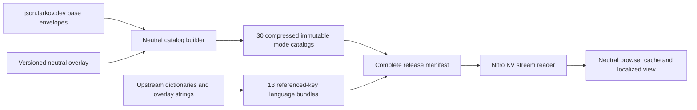

# Game data

Part of the [systems spec](./README.md).

## Tarkov.dev data integration

Game catalogs come from `json.tarkov.dev` through Tracker's adapters and overlay.
The scheduled producer prepares language-neutral catalogs once per mode and a
single string bundle per selectable API language. Production `/api/tarkov/*`
readers stream those prepared objects from `TARKOV_DATA`. The browser loads neutral
catalogs by mode and resolves display strings from its selected language bundle.

The mode slugs are `regular`, `pve`, and `pvp-season`, corresponding to internal
`pvp`, `pve`, and `seasonal`. Invalid mode values default to `regular`. The strings
route defaults an unrecognized locale to `en`. The 14 UI locales map to 13 API
languages, with Ukrainian using the English game-data bundle. Both lists derive
from `SUPPORTED_LOCALES` and `LOCALE_TO_API_MAPPING`.

### Supported languages

`cs`, `de`, `en`, `es`, `fr`, `it`, `ja`, `ko`, `pl`, `pt`, `ru`, `tr`, `uk`, and `zh`.

### Endpoints

| Endpoint                           | Scope            | Content                                                  |
| ---------------------------------- | ---------------- | -------------------------------------------------------- |
| `/api/tarkov/bootstrap`            | mode             | Player levels                                            |
| `/api/tarkov/tasks-core`           | mode             | Tasks, maps, traders                                     |
| `/api/tarkov/tasks-objectives`     | mode             | Task objectives                                          |
| `/api/tarkov/tasks-rewards`        | mode             | Task rewards                                             |
| `/api/tarkov/hideout`              | mode             | Stations and crafts                                      |
| `/api/tarkov/items-lite`           | mode             | Minimal item projection                                  |
| `/api/tarkov/items`                | mode             | Full items                                               |
| `/api/tarkov/prestige`             | mode             | Prestige levels                                          |
| `/api/tarkov/editions`             | mode             | Editions, story chapters, seasonal perks                 |
| `/api/tarkov/map-spawns`           | mode             | Map spawn points                                         |
| `/api/tarkov/strings`              | API language     | Referenced strings for every mode, with English fallback |
| `/api/tarkov/tasks-import`         | mode, English    | Whole validated EFT import catalog                       |
| `/api/tarkov/extract-requirements` | all modes        | Overlay extract rules and cues                           |
| `/api/tarkov/overlay-status`       | complete release | Activated catalog manifest                               |
| `/api/tarkov/cache-meta`           | operational      | Browser purge marker                                     |
| `/api/tarkov/access-check`         | operational      | Browser clearance probe                                  |

The ten neutral datasets accept `gameMode`; their release keys have no language
component. `strings?lang=` covers all modes in one response. Every neutral catalog
and strings response has `Cache-Control: no-store`, `X-Cache-Status: PRECOMPUTE`,
and `X-Catalog-Release`. Overlay-bearing scopes also include overlay identity
headers. Bootstrap and map-spawns are upstream-only and have no `dataOverlay`.

Every GET endpoint has an explicit HEAD counterpart. Unknown `/api/tarkov/*`
paths return HTTP 404 JSON with `Cache-Control: no-store` and stay within the API
namespace. The compiled Worker regression checks GET and HEAD for every route.

### Producer and reader

The producer adapts the base envelopes while keeping declared translatable fields
as references. It applies mode corrections and overlay additions once. It gathers
references from the final adapted catalogs, resolves requested-language and English
fallback values on the server, and publishes only referenced keys in each bundle.
Upstream references include their mode and endpoint because equal upstream keys
can have different values across those scopes. Entity IDs and object keys stay
unchanged even when an upstream objective ID is also its description's string key.
`@tt:link` references preserve URL validation, `@tt:template:hand-over` captures
generated multi-item objective descriptions, and `@tt:override` binds a locale
field correction to its mode-specific fallback.

The producer gzips each JSON object, stores it under
`neutral-catalog-v1/<scope>/<sha256-of-uncompressed-JSON>`, and reads it back before
activation. `neutral-catalog-v1-manifest` names the complete 30 catalog and 13
language objects. The reader fetches that manifest and streams the selected object
through decompression. A successful active release can reuse its compressed per-colo Cache API copy.
During a KV failure, an eligible last-good copy is served with
`X-Cache-Status: STALE`. Without one, a missing manifest or object returns 503. Production catalog
requests have no live upstream fallback.

`tasks-import` remains a separate whole English snapshot per mode, validated for
scope, bounded age, objective structure, and overlay identity. Import consumers
never assemble it from independently refreshed UI catalogs. See the release
procedure in [Overlay and precompute](./overlay-and-precompute.md#precompute-workflow).

### Browser cache and translation

IndexedDB schema 9 stores neutral catalogs under `neutral-v1` mode scopes and
string tables under `strings-v1` language scopes. Numeric bootstrap data retains
its existing mode-scoped cache. A localized view is materialized
for consumers, so existing name-based search, sort, filters, and component labels
operate on resolved strings. The original neutral data remains available for a
later language switch.

With the active mode's catalogs cached, the first switch to an uncached language
loads one `strings` response. Returning to a fresh cached language loads no game-data
responses. A purge, expired entry, missing referenced key, or mode change can require
refreshes. Concurrent string requests share work within the active owner and
scope. Aborted or superseded work cannot replace the new localized view.

The browser checks the existing purge marker before accepting hydrated metadata.
Purges invalidate string tables together with neutral data. A newly published
catalog whose references exceed an older cached table triggers a string refresh.
Startup and background work retain scope checks before applying results.

### Data layers and contracts

Game data passes through four layers; each consumer should state which one it reads.

- **Raw** — the upstream `json.tarkov.dev` payload, fetched by `app/server/utils/tarkov-json.ts`.
  Overlay task patches keep this shape for trader requirements (see
  [Overlay](./overlay-and-precompute.md#behavior-details)).
- **Adapted** — the client shapes in `app/types/tarkov.ts`, produced by the adapters in
  `tarkov-json.ts` (`app/server/utils/__tests__/tarkov-json.test.ts`).
- **Overlay-corrected** — adapted data after `applyOverlay()` (`app/server/utils/overlay.ts`,
  `app/server/utils/__tests__/overlay.test.ts`); this is what `/api/tarkov/*` serves for overlay
  endpoints.
- **Application-derived** — fields TarkovTracker computes after loading, not served by upstream.
  Task `alternatives` is one: upstream removed the field, and
  `app/composables/useGraphBuilder.ts` derives it from completion-triggered `failConditions`
  (`app/composables/__tests__/useGraphBuilder.test.ts`). The API gateway reads tasks without this
  derivation; see [the data decision record](../decision-tarkov-data.md) for the open target.

The `/api/tarkov/*` routes serve the app's game catalogs. The public progress API
on `api.tarkovtracker.org` has a separately owned contract defined by
[TarkovTracker-API/src/openapi.ts](https://github.com/tarkovtracker-org/TarkovTracker-API/blob/v0.1.2/src/openapi.ts) and described in [API](../api.md).

## Upstream fetching and translation

`app/server/utils/tarkov-json.ts` owns upstream envelope fetching, adaptation,
timeouts, retries, and in-flight request deduplication. The producer's neutral
path fetches base envelopes without their language dictionaries. String building
loads dictionaries separately and resolves every referenced key before publication.
The legacy localized path remains available to explicit English import and
server-rendered consumers during the migration.

- `DEFAULT_TIMEOUT_MS` is 12,000 per attempt and `DEFAULT_MAX_RETRIES` is 2.
- Backoff is bounded and concurrent identical URLs share their in-flight request.
- Translation JSONPaths are parsed as a limited grammar without evaluating code.
  Unsupported paths are reported. Neutral publication rejects unresolved references.
- Requested-language values take precedence over English fallback. Missing values
  cannot enter an activated strings bundle.
- Items-lite omits declared translations only for fields removed by its projection.
  Retained names and properties keep their declared references. See the historical
  [items-lite CPU measurements](../evidence/items-lite-cpu-2026-11-14.md).
- Upstream and localized overlay links pass `toTrustedGameLinkUrl` before rendering.
  Client link helpers check the same HTTPS host allowlist and use ID-derived
  tarkov.dev links when necessary.

The public item checklist and hideout requirements pages use one English table
per prerendered projection to resolve all referenced item, task, and station names.
Profile and streamer consumers also resolve their catalogs before rendering.
After an admin purge, objective hydration accepts a response from the active
precomputed release when the request started in the current purge generation.
An older in-flight request or a stale fallback cannot repopulate that generation.
The public progress API is owned by TarkovTracker-API and has its own upstream
catalog cache and contracts.

## Local development and previews

A Nuxt development server without a KV binding uses `devCatalog` to run the same
neutral builders locally. Its strings request inventories every dataset and mode,
so a cold local strings build can take substantially longer than a production KV
read. Local builders need the private overlay's read-only `OVERLAY_TOKEN`.

Deployed previews use their dedicated `TARKOV_DATA` namespace. Seed a complete
neutral release and the three English import snapshots there with a reviewed
producer before testing catalog-dependent UI. Preview reads fail closed when
snapshots are missing. Production data bindings and credentials stay outside the
preview. See [preview data setup](./previews.md).

## Files and invariants

- `app/utils/catalogDatasets.ts` defines the dataset/language scope and manifest.
- `app/server/utils/neutralCatalog.ts` builds corrected neutral catalogs and strings.
- `app/server/utils/neutralOverlay.ts` verifies the sidecar and binds locale targets.
- `app/server/utils/serveCatalog.ts` serves the activated release.
- `app/utils/gameDataStrings.ts` collects and resolves value references.
- `app/utils/metadataLocalization.ts` shares language loads and creates localized views.
- `app/stores/useMetadata.ts` owns mode-scoped browser metadata and hydration.
- `scripts/precompute/catalog-release.ts` publishes verified immutable objects.
- `scripts/precompute/check-overlay.ts` certifies the complete served release and imports.

All browser game-data requests use `/api/tarkov/*`. The retired GraphQL API is outside
this data path. Production catalog handlers read prepared snapshots, and upstream
work stays in reviewed producers. The manifest is activated only after every
required scope passes its storage and provenance checks. The verifier requires all
43 scopes to be current and preserves failure evidence for each import mode.
