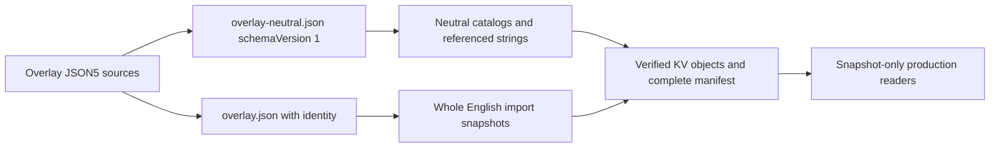

# Overlay and precompute

Story objective `completionPolicy: 'tutorial'` is an effective completed baseline
in every mode and after prestige, reset or import. Its accepted evidence is the
user's gameplay confirmation, not captured account state. The overlay attaches
it only to Escape Ground Zero; Tracker never matches localized text or specific
IDs to infer this policy. Missing/unknown policies retain normal tracked behavior.

`storylineCompletion.ts` owns the metadata-driven read projection for Tracker's
storyline UI and Nitro profile adapter. It keeps Therapist and chapter completion
independent, and is used by objective totals, availability, trader-lock reads and
prestige requirements. Individual/bulk edit guards skip automatic objectives.
Current-store and teammate consumers apply policy only when the loaded
`storyChaptersGameMode` matches that store's mode; a mode switch never borrows
the previous catalog. Isolated profile views use their own viewed-mode catalog.
Rendering never writes a mark, completion time or activity history. Stored marks
remain reversible if producer evidence changes.

Backup exports/imports and cloud synchronization retain recorded progress,
including old false marks. Shared-profile HTTP `data.storyChapters` is an effective
read model when policy metadata is available; it is not a backup format and adds
no inferred objective timestamp. An account with no materialized progress can
therefore return only its automatic storyline baseline. On unavailable/old metadata it preserves recorded
progress. The profile UI projects its viewed mode's catalog independently. The
public token API currently exposes no storyline progress and is unchanged. A
future rule shared with that API belongs in its progress-contracts package.

Part of the [systems spec](./README.md): summary, flow, files, and invariants per system.

## Precompute credential boundary

Production precompute runs only from `refs/heads/main` and checks out the immutable event SHA.
The `production-precompute` GitHub environment must allow deployments from the `main` branch only,
with no tag rule. Store `CLOUDFLARE_API_TOKEN` and `OVERLAY_TOKEN` only in that environment. A job
condition alone is insufficient: a branch author can change its workflow, so the environment policy
and absence of repository-level credential copies provide the external boundary.

Before merging this safeguard, an authorized operator must coordinate the following credential
migration with a recent successful precompute run (snapshots expire after seven days):

1. Create `production-precompute` with selected deployment branches and a single branch rule for
   `main`; verify the policy through the GitHub environment API or repository settings.
2. Provision replacement credentials: Cloudflare Workers KV Storage Edit restricted to the owning
   account, and read-only Contents access restricted to the private overlay repository. Inventory
   every consumer before revocation: the Pages runtime also reads `OVERLAY_TOKEN`; if it shares
   the old credential, provision its replacement through Pages' production secret configuration.
   GitHub's encrypted secret metadata cannot establish whether those values are shared. Store the
   precompute replacements
   with `gh secret set CLOUDFLARE_API_TOKEN --env production-precompute` and
   `gh secret set OVERLAY_TOKEN --env production-precompute`; provide values through private input.
3. Recheck all workflow consumers, then remove the repository-scoped copies with
   `gh secret delete CLOUDFLARE_API_TOKEN`, `gh secret delete CF_API_TOKEN` (the legacy alias),
   and `gh secret delete OVERLAY_TOKEN`, and revoke their old platform credentials. Coordinate this step with the reviewed workflow merge; do not declare the
   finding resolved while any repository copy remains accessible. Inspect queued and in-flight
   workflow runs before cutover: repository secrets are captured when a run is queued, so deleting
   the repository copies alone does not revoke those snapshots. Old credentials must also be
   revoked at their providers after all legitimate consumers use their replacements.
4. Verify the environment remains main-only and that a non-main dispatch cannot obtain these
   credentials. Run the reviewed main workflow through the approved operational process and verify
   snapshot freshness. Never test the boundary by exposing a secret in output.

These are manual production credential changes requiring explicit authorization. A local workflow
test verifies the committed safeguards, not the live environment policy or secret placement.

## Overlay corrections

The overlay corrects community-maintained game data and adds missing entities. The
producer reads the versioned `overlay-neutral.json` sidecar, applies global and mode
corrections to adapted neutral data, and publishes independent language tables.
English import snapshots continue to use the matching `overlay.json` artifact.
Both artifacts carry their own content digest, and the sidecar's `$source` binds
it to the legacy artifact's identity.

### Flow

### Neutral strings and corrections

The sidecar replaces display fields with `@tt:overlay:/...` keys. Its `$strings`
contains English defaults and sparse language overrides. `$localeTargets` binds
locale-only corrections to their entity fields while retaining the original
mode-specific upstream reference as fallback. The bundle builder resolves
requested-language, English-overlay, and upstream-English fallbacks before
publication. Localized wiki links follow this field table and pass the existing
trusted-link validation before rendering.

Overlay additions supply their own stable keys and English defaults. Task and item
additions share their entity key namespaces, mode-specific defaults include the
mode, and objective arrays use their IDs for stable paths. Machine identifiers,
normalized names, mechanical extract names, and exit-status discriminators retain
their original values. Unsupported or non-string locale leaves stop publication.

To add a correction, edit the overlay repository's ID-keyed JSON5 override or
addition. Put a canonical English correction in the shared or mode source and a
locale-only correction in the [overlay locale source directory](https://github.com/tarkovtracker-org/tarkov-data-overlay/tree/main/src/overrides/locales). Include the
entity name, previous value, and supporting evidence. Run overlay validation,
tests, typecheck, and build. Submit sources and let the overlay release workflow
publish both generated artifacts. The complete producer contract is in the overlay
repository's [neutral overlay guide](https://github.com/tarkovtracker-org/tarkov-data-overlay/blob/main/docs/NEUTRAL_OVERLAY.md). `OVERLAY_URL` and
`NEUTRAL_OVERLAY_URL` can select the matching legacy and neutral artifacts. Pin
both to the same immutable release or source revision when overriding defaults.

### Behavior details

The following merge rules are shared by neutral production and the legacy English
import builder. Legacy fetch caching details apply to `overlay.ts`, while neutral
catalog generation uses `neutralOverlay.ts` and publishes immutable results.

- The legacy loader has a module-level 1-hour overlay cache. The neutral loader also
  caches verified sidecar snapshots for one hour and shares concurrent refreshes.
- The legacy configured overlay URL must use HTTPS. Invalid URLs and non-HTTPS schemes fall back to the
  trusted `raw.githubusercontent.com` source so corrections cannot be modified in transit.
- Redirects are followed manually (`redirect: 'manual'`) for at most `MAX_OVERLAY_REDIRECTS = 3`
  hops, and every hop must also be HTTPS. A redirect to a non-HTTPS target, a redirect without a
  `location` header, or exceeding the hop limit aborts the fetch and leaves the previous overlay in
  place.
- Overlay task patches carry trader requirements in the raw upstream shape: one
  `traderRequirements` list discriminated by `requirementType` (`level` gates
  trader loyalty level, `reputation` gates standing). `applyOverlay` re-splits
  a patched task's merged list into `traderLevelRequirements` and
  `traderRequirements` (reputation-only) for compatibility, and regenerates the canonical
  `normalizedTraderRequirements` consumed by availability, badges and progress implications
  ([canonical task progression](./tasks.md#canonical-task-progression)). A patch's `traderRequirements` replaces the whole requirement set.
- Overlay corrections and `tasksAdd` entries merge into already-adapted tasks, so `applyOverlay`
  re-normalizes the declared prerequisite and prestige gates it can reach. A corrected task is
  re-normalized only when the patch touches `taskRequirements` or `requiredPrestige`, and a
  recomputation clears only the diagnostic for the field that patch rewrote: the adapter already
  dropped the other malformed value, so its diagnostic is retained rather than recomputed away. Every
  injected task is re-normalized because additions never pass through the adapter. `taskRequirements`
  stays a list and a resolvable `requiredPrestige` becomes a normalized `{ id }` reference. The
  overlay keeps an id-less `{ name, prestigeLevel }` reference verbatim, so it is not a loss and gets
  no diagnostic; only a declared gate the normalization had to drop becomes a
  `requirementDiagnostics` entry ([canonical task progression](./tasks.md#canonical-task-progression)).
- The legacy loader can retain its last-good overlay after a fetch failure. Failure before the neutral
  manifest is written leaves the previous release active. A failed readback after
  the write leaves the new pointer potentially active. Verify its release identity
  and served objects before retrying or promoting a reader.
- Overlay supports mode-specific corrections under `modes[gameMode]` plus global corrections.
- Objective adaptation preserves weapon lists and grouped weapon modifications and clothing.
  Legacy scalar and flat references retain their shape. Explicit empty lists remain empty,
  malformed leaves remain `{ id: '' }`, and unknown nonempty IDs are retained.
  Hydration preserves the groups. Task and map item previews flatten equipment for display.
  A complete precompute run from the updated producer publishes the corrected references.
- In the legacy artifact, `locales[locale]` patches fields after shared and mode
  corrections. The neutral sidecar compiles those corrections into key overrides
  and field-target bindings with the same precedence.
- `tasksAdd` lets the overlay inject entirely new tasks not present upstream.
  Omitted `failConditions` become an empty list; explicitly malformed values remain unchanged
  so import snapshot validation can reject them.
- Objective post-processing (`objectiveTypeInferrer.ts`) normalizes objective lists and infers
  `foundInRaid` flags so the client does not have to guess.
- `bypassCache: true` (from `shouldBypassCache`) forces an awaited overlay refresh — used after
  publishing a correction.
  Production catalog readers use the activated neutral snapshots for hideout,
  objectives, editions, and the other hot datasets. Publishing a correction requires
  a complete precompute run and browser purge-marker invalidation. A purge clears
  browser metadata and strings. It does not rebuild or replace the neutral manifest.
  Precompute must finish before the purge so clients reload the intended complete
  release. Failed staging keeps the previous manifest available until its retention
  expires. Reader-side KV failures can serve an eligible compressed last-good Cache
  API response marked `STALE`. Missing snapshots without such a copy return 503.

Historical releases used `json-v5` objective/hideout caches with per-colo live
refreshes. Those request-path semantics describe earlier deployments. The neutral
reader streams precomputed snapshots and has no live upstream fallback.

The raw overlay JSON and `OVERLAY_TOKEN` remain server-side. The browser consumes corrected
task/objective data and overlay identity metadata; applied corrections are therefore visible in
those catalogs. `/overlay/kappa/**` serves the streamer UI, not the private source JSON.

### Endpoint ownership and precedence

The table describes build-time catalog ownership. Production hot routes read the
resulting snapshots. The English import and extract-rule paths retain their
separate overlay readers.

Every collection merges shared records by ID, then the matching upstream mode (`regular`, `pve`,
`pvp-season`), then supported locale patches. `overlayValidation.ts` validates known collection
shapes, perk filters, craft additions and prestige chapter/objective references before replacing
the last-good overlay. Unsupported story statuses/types fail validation. Unknown root, mode or
locale sections are logged and retained in `dataOverlay.unconsumedSections`, including cache hits;
precompute refuses to publish payloads with unconsumed sections.

The root `taskIdAliases` ledger is recognized only when it has exactly the version-1 schema:
`schemaVersion: 1` and all three mode maps, each containing empty `tasks` and `objectives` records.
This inactive ledger has no identities to apply. Populated maps, malformed ledgers, unknown fields
or versions, and mode/locale-scoped ledgers remain unconsumed so precompute retains last-good KV
entries. Active aliases require the complete consumer rollout tracked in
[#1302](https://github.com/tarkovtracker-org/TarkovTracker/issues/1302); this compatibility check
does not activate progress migration or change catalog identities.

| Sections                               | Consumer and identity rules                                                                                                                                                                                                                                                                                                                                                                                                                                                                                                                                    |
| -------------------------------------- | -------------------------------------------------------------------------------------------------------------------------------------------------------------------------------------------------------------------------------------------------------------------------------------------------------------------------------------------------------------------------------------------------------------------------------------------------------------------------------------------------------------------------------------------------------------- |
| `tasks`, `tasksAdd`, `traders`, `maps` | Task catalog builders; existing task IDs win over synthetic additions; maps support locale patches. A map's `extractsAdd` appends well-formed extracts (non-empty `id`/`name`, known or null faction, finite position) whose ID or name is not already present, then is removed from the response; the client applies the same rule to `app/data/maps.json` `extractsAdd`, whose `nameKey` resolves the label through i18n and is copied onto a matching upstream extract that lacks one.                                                                      |
| `items`, `itemsAdd`                    | Both item catalog builders; adapt additions only when an ID is absent upstream, then apply explicit patches and locales.                                                                                                                                                                                                                                                                                                                                                                                                                                       |
| `hideout`, `craftsAdd`                 | Hideout; attach adapted crafts to station ID/level and deduplicate craft IDs globally. Null/absent task unlocks stay `unlockState: unknown`.                                                                                                                                                                                                                                                                                                                                                                                                                   |
| `prestige`                             | Prestige builder; patch/append raw conditions by ID before adaptation resolves tasks from upstream plus missing, enabled `tasksAdd` IDs. Array condition patches replace arrays. Locale task/prestige corrections apply before resolution.                                                                                                                                                                                                                                                                                                                     |
| `storyChapters`                        | Editions builder and task story unlock projection share chapter identities. Chapter/objective locales supply prestige story requirement names. Stored story progress is evaluated from explicit requirements, never chapter order or hardcoded chapter-name lists. Chapter `endings`, `mutuallyExclusiveQuestPairs`, `referenceCoverage`, and objective `sourceQuestId`/`endingId` survive projection and normalization; the storyline view reads them when a chapter carries them and falls back to objective-level exclusivity and objective text otherwise. |
| `editions`                             | Editions builder and metadata store own the mode-scoped edition catalog.                                                                                                                                                                                                                                                                                                                                                                                                                                                                                       |
| `seasonalPerks`                        | Editions catalog exposes metadata only for `pvp-season`; the store's `resolvedSeasonalPerks` hydrates item/category references as items load, retaining missing IDs with null values. No perk selection/progress persistence is introduced.                                                                                                                                                                                                                                                                                                                    |
| `extractRequirements`, `extractCues`   | Extract-requirements route serves both root sections together for every mode; `data` is null until both are valid, and the map shows unknown requirements until then. Each is recognized only when it passes the shared `app/utils/extractRuleData.ts` checks, so a malformed section stays unconsumed and precompute refuses to publish, like `progressionCounters`. Mode- or locale-scoped copies are unconsumed.                                                                                                                                            |

Story objective `unlocks` survive projection and normalization and determine step placement
directly. Unplaced map/trader unlocks and chapter reward summaries remain chapter-level;
the view never infers unlock timing from text or distributes rewards across objectives.
Tour's ordered objective array follows the wiki narrative while retaining raw objective IDs
and source-subquest links. Stage-completion notes remain available on unlock badges.

Optional `parentObjectiveId` values come from the overlay's captured condition parents.
Projection and client normalization retain a link only when the child is `optional` and it targets
a distinct `main` objective in the same chapter with the same nonempty `sourceQuestId`; an invalid
link is dropped without dropping its objective. The timeline groups linked optionals beside their main step (below it
on narrow screens), supporting several children and parents inside route decisions. Unlinked
optionals keep their original positions. Each objective retains its own checkbox, deep link,
unlocks and completion state; layout parents never imply completion, prerequisites or item-supply
relationships. Older overlays without this field keep the standalone layout.

Prestige fetches the requested upstream mode, preserving mode-specific gates and
metadata. Most neutral catalogs use `neutral-v1` mode scopes. Objectives use `neutral-v2`
to retire browser snapshots with incomplete equipment. String tables use `strings-v1`
language scopes. IndexedDB schema 9 clears the older
localized payload layout. Superseded scope responses cannot replace the active
mode's data. Story references name own chapter entries, and seasonal perk exclusion
lists contain only string IDs.

Seasonal perk membership and metadata come from `pvp-season/season`. The neutral
builder retains references for names and descriptions, validates the upstream
schema and exclusions, and applies effects only to existing IDs. Missing,
duplicate, or incompatible upstream identities stop publication. The string
builder resolves every declared season key using the requested language and
English fallback. Failed generation leaves the previous complete release active.

The older progression/overlay rollout used `json-v3` task core, `json-v5` hideout,
`overlay-v3` editions, envelope format 2, and IndexedDB schema 8. Those versions are
historical release contracts and stay separate from neutral catalog keys.

Story chapter branches follow the overlay's own evidence. Objective-level `mutuallyExclusiveWith`
blocks the opposing objective; chapter-level `mutuallyExclusiveQuestPairs` constrains only whole
sub-quests, so each declared pair becomes one chapter-level route choice and gates chapter bulk
completion, while individual objective toggles stay enabled. Pairs are never merged: two pairs
sharing a quest do not make their other members exclusive, and a route the player has not finished
is never rendered as blocked, because the objective list can be a projection of the overlay capture.
Both sides of a declared pair always render, a side with no captured objectives reporting pending
evidence rather than disappearing. A route is called chosen only when chapter coverage is complete and
exactly one side's steps are all done; under partial coverage a finished side reports known-step
progress instead, and a conflict between two finished sides is reported only when coverage is complete,
because unknown steps can otherwise remain on both.
Declared `endings` replace the text-derived ending labels when a chapter carries them — chapters
without them keep the text path — an ending with no attributed objectives reports pending evidence
rather than being hidden, and exclusivity between endings is not inferred. `referenceCoverage.partial`
surfaces as a chapter badge because a missing objective is not evidence that none exists. Objective
IDs are upstream-owned: completed marks the reconciliation pass below leaves unresolved are reported
for re-checking on the viewer's own progress only, never remapped on a guess.

Saved story objective marks are reconciled against the published catalog by
`app/utils/storyProgressMigration.ts`, on every chapter-catalog load and after a realtime merge,
which unions both sides' objective IDs and can reintroduce a retired one. Only the mode the loaded
catalog belongs to is reconciled: neutral chapters are fetched per mode and the overlay may scope
a chapter to one mode, so a catalog is evidence about its own mode only. A merge naming another mode is
deferred to that mode's own catalog load, which a mode switch or the next start performs. The pass is idempotent and acts
only on proof: a mark moves when `STORY_OBJECTIVE_ID_ALIASES` records a re-key the published data
proves (identical unique objective text, or the overlay re-anchoring its own prestige requirement),
the catalog publishes that successor, and the successor carries no mark of its own; a mark whose
successor a partial chapter omits is kept until the successor appears, because that objective list is a
projection, while a complete chapter that omits it settles the question and the mark is dropped; a mark
is also dropped when no alias names it and its ID cannot satisfy the story schema's client-ID shape, so
it can never resolve again and would otherwise be re-synced forever, and when the successor already
carries the player's own mark; an unrecognized client ID is kept for the projection reason. Lookups use own properties, so an
inherited key such as `constructor` is treated as saved data rather than as a published objective. Nothing is dropped unless the loaded chapter itself proves the client-ID contract, so a
stale, curated, or failed catalog load cannot delete progress. Ambiguous re-keys are left unmapped
rather than guessed. Task and hideout IDs have no equivalent pass: the overlay still publishes
synthetic task IDs (`new_beginning_prestige_5`) as live data, so absence there is not proof of
retirement, and a future retirement needs the overlay to declare the replacement first.

### Files

- `app/server/utils/overlay.ts` — fetch, cache, merge, and deferred refresh coordination.
- `app/server/utils/backgroundTask.ts` — keeps deferred refreshes alive through the Cloudflare
  execution context.
- `app/server/utils/overlayResponseHeaders.ts` — restores overlay metadata headers when corrections
  are applied after an edge-cache read.
- `app/server/utils/deepMerge.ts` — `deepMerge` + `isPlainObject`.
- `app/server/utils/objectiveTypeInferrer.ts` — objective normalization.

### Invariants

- Neutral publication requires a valid sidecar with a verified digest, supported
  schema, consumed sections, and matching source-overlay identity. A missing
  overlay cannot be promoted as authoritative eligibility data.
- The private overlay and its read-only `OVERLAY_TOKEN` stay server-side. Auth
  headers attach only to trusted GitHub HTTPS hosts and never appear in logs.
- Overlay URLs and every redirect hop use HTTPS. The neutral loader rejects an
  insecure URL or redirect and bounds redirects and request timeouts.
- Overlay identity is preserved in the manifest, payload, and response headers.
  Upstream-only bootstrap and map-spawns remain exempt from payload overlay metadata.
- English import snapshots preserve their independent scope, age, task/objective,
  and provenance validation. Language switching cannot alter imported IDs.

## Precompute workflow

The GitHub Actions producer performs upstream fetch, adaptation, overlay merging,
reference collection, and language fallback off the Pages request path. It runs
on the 12-hour schedule and through the existing manual dispatch. A full release
contains ten neutral datasets for each of the three modes and one bundle for each
of the 13 selectable API languages. The three whole English import snapshots are
produced and validated separately by the same trusted runner.

### Key and activation contract

- The KV binding name is `TARKOV_DATA`. Every neutral object uses
  `neutral-catalog-v1/<dataset>/<mode>/<digest>` or
  `neutral-catalog-v1/strings/<language>/<digest>`.
- The digest is SHA256 of the uncompressed UTF-8 JSON. The producer stores gzip
  bytes, enforces the KV object-size limit, and reads the compressed object back
  byte-for-byte before including it in the release.
- `neutral-catalog-v1-manifest` records `completedAt`, `overlaySha`, and exactly
  43 entries. Each entry records its immutable key, uncompressed byte length, and
  overlay response headers.
- The manifest is replaced only after all required objects and references pass.
  Failed staging preserves the previous manifest. Readers use one complete release
  pointer, with the usual KV replication behavior. Old immutable objects remain
  readable within their seven-day retention.
- Whole English imports keep `tasks-import-json-v1-en-<mode>` keys and their
  existing envelope validation. A complete neutral manifest alone does not certify
  that all three import snapshots are ready.
- Filtered maintenance runs do not activate a neutral manifest. Initial migration
  releases also refreshed the earlier localized fleet while old readers were live.
  Those 48 legacy entries are outside the neutral release's 43-scope contract.

### Reader behavior

`serveCatalog.ts` reads the manifest on each request, finds the exact dataset/mode
or strings/language scope, and streams the referenced compressed object through
decompression. Responses use `no-store`, `X-Cache-Status: PRECOMPUTE`, and the
manifest's `X-Catalog-Release` timestamp. A compressed per-colo Cache API copy can
be reused after the active manifest confirms its immutable key and release. KV
failure may serve that last-good copy with `X-Cache-Status: STALE`. Without an
eligible copy, a missing entry or body returns 503. A stale fallback keeps the UI
available and cannot pass release verification.

The producer and reader share per-dataset uncompressed size limits from
`catalogDatasets.ts`. The reader checks the declared length, opens the
decompressed stream before sending headers, and counts bytes as it streams.
A first-read error can use a last-good copy. An interruption after response
bytes have been sent terminates the stream; callers can retry the request.

Bootstrap and map-spawns have no overlay body identity. Every other neutral scope
and every strings bundle carries the release's source-overlay identity. The
public API gateway in TarkovTracker-API retains its independently owned upstream
catalog cache and does not read these Pages catalog objects.

### Release order

1. Merge and release the overlay producer that publishes `overlay-neutral.json`
   alongside the existing artifact. Verify both digests and their shared source
   identity. Keep the old artifact available for imports and the deployed reader.
2. Merge a reviewed Tracker producer that writes the new keys while the deployed
   consumer still reads its existing contract. During this migration the runner
   writes both the legacy fleet and neutral release.
3. Dispatch **Precompute Tarkov Data** on `main` with `expectedOverlaySha` set to
   the intended legacy-overlay digest and both filters empty. Production
   credentials remain inside the `production-precompute` environment.
4. Inspect `precompute-manifest.json` from the run. Require the intended
   `catalogRelease.overlaySha`, the exact 30 catalog and 13 language scopes,
   successful immutable-object readbacks, and all three successful English imports.
5. Promote the Tracker reader only after those objects are available in the
   production namespace. Run `pnpm run verify:overlay` against production and
   require all 43 scopes and three imports to be current.
6. Allow at least 90 seconds after the producer confirms the active pointer write
   before purging browser metadata. This covers the default 60-second KV read cache
   in other colos. Recheck the intended manifest immediately before the Tarkov data
   purge. If publication changed, verify the new release and restart the wait.
   Measure a first switch into an uncached language and a return to a fresh cached
   language. Require one strings request and zero game-data requests respectively,
   with mode-specific objective text and stable IDs in each mode.
7. Retire the legacy localized producer after consumer promotion and verification.
   Retain the English import snapshot producer and the legacy overlay artifact it
   consumes. Close the issue with the exact release, precompute, and browser evidence.

New incompatible snapshot contracts follow the same producer-before-consumer
order. Production Pages deploys `main` automatically. Hold a consumer PR in draft
until the reviewed producer has seeded its keys, and do not treat a successful
older producer or a release run from another namespace as readiness evidence.

### Release verification

`pnpm run verify:overlay` uses `https://tarkovtracker.org` by default. An explicitly
configured HTTPS `TARKOV_OPERATIONS_ORIGIN` can select the authorized operations
host. Paired Access service credentials require that explicit origin. Redirects
are forbidden and credentials are sent only to that selected origin. The overlay
source still needs its read-only `OVERLAY_TOKEN` when private.

The verifier requires a fresh published-overlay read, a current complete manifest, and its intended overlay
SHA with the exact expected scope set derived from application constants. It reads
every response as bytes and checks the immutable-key digest, byte length,
precompute source, no-store policy, release timestamp, and overlay headers and body
identity. The release must be at most 14 hours old, covering the 12-hour schedule
plus operational allowance. Every scope must pass. There is no propagating-success
state for release certification.

The checker reads the manifest again after its checks. If publication changed it,
it retries the complete observation once. A second change fails certification.
All three whole English imports are checked independently for their whole-catalog
shape, English/mode scope, matching overlay, precompute source, and headers. Their
endpoint also enforces the bounded stored snapshot age.

The command writes a unique private temporary `report.json` with keys, digests,
lengths, statuses, and failure reasons, then prints its path and aggregate counts.
It records every scope and import failure while omitting raw private overlay and
catalog payloads. Missing data, fetch errors, stale releases, or partial reads
produce a nonzero exit code.

### Local and preview data

A Nuxt development server without KV uses the same builders through `devCatalog`.
Supply `OVERLAY_TOKEN` locally. A first strings build inventories all neutral
catalogs and modes, which can be expensive on a cold development server. Local
live building is limited to development and does not establish production
precompute readiness.

Production and preview namespaces are separate. The preview namespace needs its
own complete 43-object release and all three English imports from a reviewed
producer before catalog-dependent UI verification. An English-only legacy seed
cannot satisfy neutral readers. Use an approved broker writer or authorized
operator workflow with the preview namespace selected explicitly. Keep production
credentials out of preview builds and candidate code. Refresh the preview release
before expiry and recheck its identity because all preview branches share that
expendable namespace. See [Pull-request previews](./previews.md).

### Files

- `scripts/precompute/catalog-release.ts` stages and reads back immutable objects,
  then activates the complete manifest.
- `scripts/precompute/run.ts` is the trusted scheduled/manual entry point.
- `scripts/precompute/import-snapshots.ts` preserves whole English import snapshots.
- `scripts/precompute/kv.ts` owns KV REST reads and writes.
- `scripts/precompute/check-overlay.ts` checks the complete served release.
- `scripts/precompute/verify-catalog-release.ts` verifies scope, freshness, headers,
  raw response bytes, and overlay identity.
- `app/utils/catalogDatasets.ts` defines release scopes and manifest types.
- `app/server/utils/serveCatalog.ts` streams the activated catalog release.
- `.github/workflows/precompute-tarkov-data.yml` owns schedule, dispatch, and the
  production credential boundary.

### Invariants

A full release uses one source-overlay SHA. Neutral dataset edges fetch base
upstream envelopes only, and language dictionaries are built separately. All
referenced keys resolve before activation. The browser's mode data and language
tables have separate cache namespaces. Whole imports preserve progress-critical
IDs and remain independently validated. Verifier failures leave diagnostic
evidence and block release certification.
